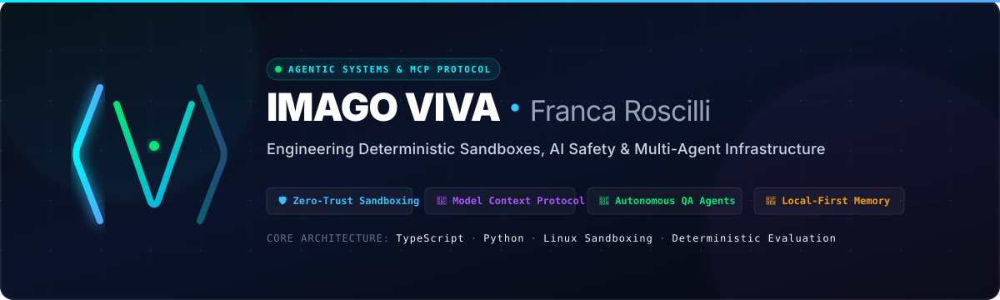

<p align="center">
  
</p>

<p align="center">
  <a href="https://github.com/francaroscillidev-gif"></a>
  <a href="https://github.com/francaroscillidev-gif"></a>
  <a href="https://github.com/francaroscillidev-gif"></a>
  <a href="mailto:francaroscillidev@gmail.com"></a>
</p>

---

### ⚡ Executive Summary

**Imago Viva** (directed by **Franca Roscilli**) specializes in architectural defense, protocol interoperability, and runtime execution guarantees for Large Language Models and autonomous AI agents. 

Our open-source suite addresses the critical gaps in enterprise AI adoption: **tool hallucination, runtime drift, prompt injection, memory degradation, and unmonitored subagent execution**.

```ascii
 ┌─────────────────────────────────────────────────────────────────────────────┐
 │                       THE AGENTIC RESILIENCE STACK                          │
 ├─────────────────────────┬─────────────────────────┬─────────────────────────┤
 │     1. SECURITY LAYER   │   2. PROTOCOL & RUNTIME │  3. RELIABILITY & TEST  │
 │  • agentarmor           │  • driftguard-mcp       │  • autoheal             │
 │  • agentguard           │  • universal-mcp-bridge │  • git-native-spec-code │
 │  • shadow-agent         │  • synapse-memory       │  • agent-arena          │
 └─────────────────────────┴─────────────────────────┴─────────────────────────┘
```

---

### 🛡️ Architectural Pillars & Core Ecosystem

#### 1. Zero-Trust Security & Agent Governance
- **[agentarmor](https://github.com/francaroscillidev-gif/agentarmor)**: Deterministic execution sandbox with strict eBPF/Linux boundary enforcement, preventing unauthorized file/network escalation during tool execution.
- **[agentguard](https://github.com/francaroscillidev-gif/agentguard)**: Real-time sentinel preventing hallucinated dependencies, cognitive scope drift, and generative code degradation.
- **[shadow-agent](https://github.com/francaroscillidev-gif/shadow-agent)**: Privacy-preserving masking proxy and PII scrubber before prompts reach commercial inference providers.
- **[smart-shell-guardrail](https://github.com/francaroscillidev-gif/smart-shell-guardrail)**: Autonomous guardrail for shell and CLI workflows preventing catastrophic system modifications.

#### 2. Model Context Protocol (MCP) & Runtime Diagnostics
- **[driftguard-mcp](https://github.com/francaroscillidev-gif/driftguard-mcp)**: Flight-recorder and runtime doctor for Claude, Cursor, and multi-agent loops—offering instant state snapshots, rollback, and port diagnostics.
- **[universal-mcp-bridge](https://github.com/francaroscillidev-gif/universal-mcp-bridge)**: High-throughput dynamic proxy transforming any OpenAPI/REST schema, CLI binary, SQLite DB, or Bash script into an MCP-compliant endpoint.
- **[synapse-memory](https://github.com/francaroscillidev-gif/synapse-memory)**: Local-first, vector-backed long-term memory engine with cognitive temporal decay and selective retrieval.
- **[mcp-nextgen-suite](https://github.com/francaroscillidev-gif/mcp-nextgen-suite)**: Token-efficient generator and protocol optimizer for custom MCP servers.

#### 3. Autonomous Verification & Self-Healing Testing
- **[autoheal](https://github.com/francaroscillidev-gif/autoheal)**: Self-healing End-to-End test suite for Playwright that repairs brittle selectors and DOM changes autonomously.
- **[git-native-spec-to-code](https://github.com/francaroscillidev-gif/git-native-spec-to-code)**: Property-based code generation pipeline with mathematical invariant verification and self-healing loops.
- **[agent-arena](https://github.com/francaroscillidev-gif/agent-arena)**: Multi-model evaluation harness benchmarking agentic decision trees under adversarial noise.

---

### 🧰 Technology Radar

<p align="left">
  <!-- Languages -->
  
  
  
  
  <!-- AI / Agentic -->
  
  
  
  
  <!-- Infra -->
  
  
  
  
</p>

---

### 📈 Activity & Metrics

<table align="center" border="0" cellpadding="0" cellspacing="0">
  <tr>
    <td align="center" width="50%">
      
    </td>
    <td align="center" width="50%">
      
    </td>
  </tr>
</table>

---

### 📬 Contact, Support & Commercial Inquiries

If you have questions, feedback, enterprise integration requests, or custom agent governance needs, feel free to reach out directly:

- **Lead Developer & Maintainer**: Franca Roscilli
- **Email**: [francaroscillidev@gmail.com](mailto:francaroscillidev@gmail.com)
- **GitHub**: [@francaroscillidev-gif](https://github.com/francaroscillidev-gif)
- **Bug Reports & Feature Requests**: Open an issue on GitHub

<p align="center">
  <sub>© Imago Viva · Engineering resilient autonomous software.</sub>
</p>
